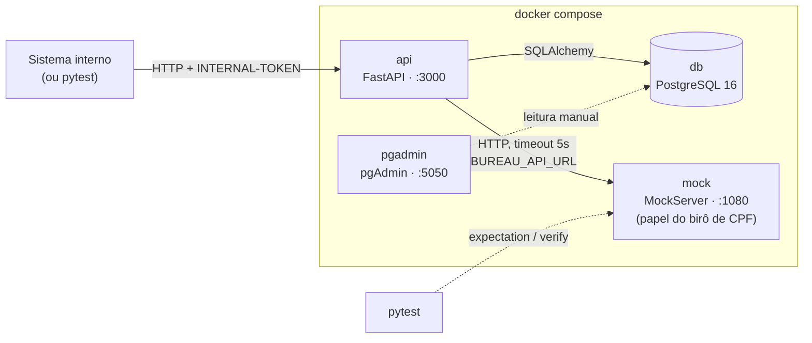
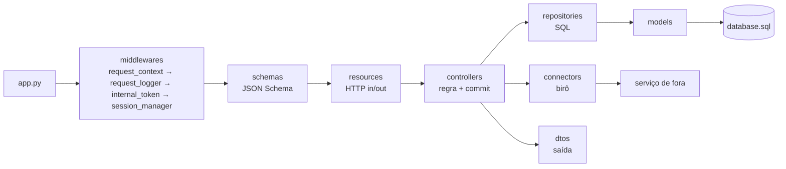

# Visão geral

> [Índice](../README.md) › Arquitetura › Visão geral
>
> **Responde a:** quais serviços sobem? quem fala com quem? o que é stateless? o que veio do `bootcamp-base-api` e o que é novo?

## Ecossistema

São quatro containers num único `docker-compose.yml`. A decisão está em [ADR 0001](decisoes/0001-monolito-com-mock-externo.md).

| Serviço | Imagem | Papel | Saúde |
|---|---|---|---|
| `api` | build local (`Dockerfile`) | Regras de cliente, conta e transação | `GET /health_check` a cada 3s |
| `db` | build de `database/` (postgres:16 + `database.sql` em initdb) | Fonte da verdade do saldo e do histórico | `pg_isready` |
| `mock` | `mockserver/mockserver:mockserver-5.11.1` | Finge ser o birô. Sobe vazio, e cada teste ensina a resposta | — |
| `pgadmin` | `dpage/pgadmin4:9.18` | Interface web para inspecionar o banco em desenvolvimento. Nem a API nem os testes dependem dele | — |

Em produção (fora do escopo):

- O `mock` dá lugar ao birô real e a API fica atrás de um API Gateway, a única porta pública.
- O `pgadmin` não sobe: é ferramenta de desenvolvimento.
- Rodam N réplicas da API atrás de um load balancer, que usa o `/health_check`.
- O auto scaling é guiado por métricas (p95 e taxa de 5xx). Escalar a API não escala o banco: cada réplica abre o próprio pool de conexões.

## A API é stateless

A sessão de banco nasce e morre em cada requisição, no middleware `session_manager`, e nada fica guardado em memória entre pedidos. Por isso qualquer réplica pode atender qualquer requisição. Toda informação de estado mora no Postgres.

## Caminho de uma requisição

A seta anda num sentido só: `resources → controllers → repositories → models`. O controller também chama `connectors`. O detalhe de cada pasta está em [camadas](camadas.md).

## Recursos do domínio

| Recurso | Pai | Responsável |
|---|---|---|
| `customer` | — | `CustomerController` + `BureauConnector` |
| `account` | `customer` | `AccountController` |
| `transaction` | `account` | `TransactionController` |

## O que veio da base e o que é novo

O projeto parte do [`bootcamp-base-api`](../referencia/base-service-readme.md). O exemplo `sample_entity` saiu; o resto da infraestrutura foi mantido.

| Herdado da base | Novo neste projeto |
|---|---|
| Camadas, `app.py` e a regra do `commit` como última linha do controller | Domínio `customer` → `account` → `transaction`, com rotas aninhadas por posse e 404 para recurso de outro dono |
| Middlewares de `X-Request-ID`, log, `INTERNAL-TOKEN` e sessão | Saldo em coluna com `SELECT … FOR UPDATE` em ordem de `id` e `CHECK (balance >= 0)` ([ADR 0002](decisoes/0002-saldo-em-coluna-com-lock.md)) |
| `SchemaHandler`, corpo de erro `{title, description, translation, code}` e erros `QIT000xxx` | Tabela única de lançamentos append-only, com a tarifa como lançamento `FEE` ([ADR 0003](decisoes/0003-transacao-tabela-unica-com-tipo.md)) |
| `id` interno + `<entidade>_key` UUID; padrão enumerador + tabela de eventos de status | Idempotência por `request_control_key`, comparando o corpo ([ADR 0006](decisoes/0006-idempotencia-por-chave.md)) |
| Paginação `limit`/`page` com envelope `is_last_page` | `BureauConnector` real, MockServer no compose e tradução de falha em `502`/`422` ([resiliência](../06-operacao/resiliencia.md)) |
| `RestConnector` com timeout; dígito verificador do CPF | Máquina de estados da conta (`ACTIVE ⇄ BLOCKED`, `CLOSED` final), evento na abertura e limite de contas por cliente |
| Compose com `api` e `db` e healthchecks; teste black box por HTTP | Erros `QIT0020xx`, extrato que reconstrói o saldo, 78 testes do domínio (concorrência incluída), `Makefile` e `pgadmin` |
