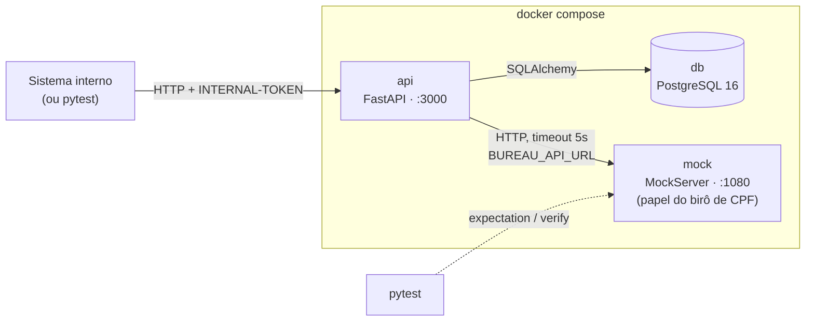
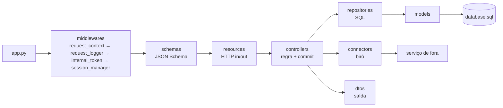

# Visão geral

> [Índice](../README.md) › Arquitetura › Visão geral
>
> **Responde a:** quais serviços sobem? quem fala com quem? o que é stateless?

## Ecossistema

São três containers num único `docker-compose.yml`. A decisão está em [ADR 0001](decisoes/0001-monolito-com-mock-externo.md).

| Serviço | Imagem | Papel | Saúde |
|---|---|---|---|
| `api` | build local (`Dockerfile`) | Regras de cliente, conta e transação | `GET /health_check` a cada 3s |
| `db` | build de `database/` (postgres:16 + `database.sql` em initdb) | Fonte da verdade do saldo e do histórico | `pg_isready` |
| `mock` | `mockserver/mockserver:mockserver-5.11.1` | Finge ser o birô. Sobe vazio, e cada teste ensina a resposta | — |

**Em produção** (fora do escopo, mas é a resposta que a banca espera):

- O `mock` dá lugar ao birô real e a API fica atrás de um API Gateway, a única porta pública.
- Rodam N réplicas da API atrás de um load balancer, que usa o `/health_check`.
- O auto scaling é guiado por métricas (p95 e taxa de 5xx). Escalar a API **não** escala o banco: cada réplica abre o próprio pool de conexões.

## A API é stateless

A sessão de banco nasce e morre em cada requisição, no middleware `session_manager`, e nada fica guardado em memória entre pedidos. Por isso qualquer réplica pode atender qualquer requisição. Toda informação de estado mora no Postgres.

## Caminho de uma requisição

A seta anda num sentido só: `resources → controllers → repositories → models`. O controller também chama `connectors`. O detalhe de cada pasta está em [camadas](camadas.md).

## Recursos do domínio

| Recurso | Pai | Responsável |
|---|---|---|
| `customer` | — | `CustomerController` + `BureauConnector` |
| `account` | `customer` | `AccountController` |
| `transaction` | `account` | `TransactionController` |
