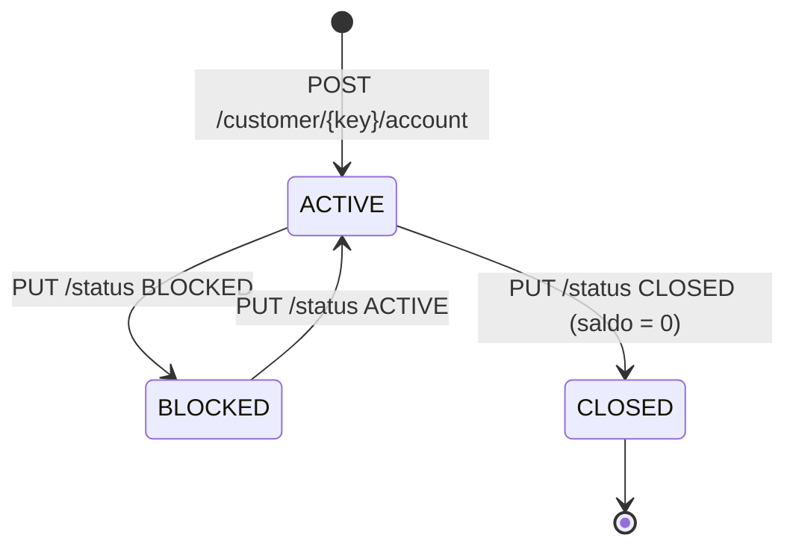

# Máquina de estados da conta

> [Índice](../README.md) › Dados › Estados
>
> **Responde a:** em que estado a conta nasce? quais transições valem? o que cada estado permite?

**A lista de estados mora no banco** (`account_status`) e **a regra de transição mora no controller** (`AccountController`). Toda transição grava uma linha em `account_status_event` no mesmo commit.

| Estado | Recebe depósito | Envia transferência | Recebe transferência | Conta no limite de contas do cliente |
|---|---|---|---|---|
| `ACTIVE` | ✅ | ✅ | ✅ | sim |
| `BLOCKED` | ❌ 409 | ❌ 409 | ❌ 409 | sim |
| `CLOSED` (final) | ❌ 409 | ❌ 409 | ❌ 409 | não |

## Regras de transição

| De → Para | Permitido? | Recusa |
|---|---|---|
| (nada) → `ACTIVE` | na abertura | — |
| `ACTIVE` → `BLOCKED` | ✅ | — |
| `BLOCKED` → `ACTIVE` | ✅ | — |
| `ACTIVE` → `CLOSED` | ✅ se `balance = 0` | `409 QIT002011` |
| `BLOCKED` → `CLOSED` | ❌ (desbloquear antes) | `409 QIT002010` |
| `CLOSED` → qualquer | ❌ estado final | `409 QIT002010` |
| X → X (mesmo estado) | ❌ | `409 QIT002010` |

## Por que não existe `CREATED`

A abertura não depende de aprovação externa. O birô é consultado no cadastro do **cliente**, não da conta. Por isso a conta nasce `ACTIVE`. O primeiro evento (`from_status_id = NULL → ACTIVE`) registra o nascimento, para que a trilha não comece pela metade, que foi a lição do "evento created" da Aula 2.

**Esta decisão seria revista se** a abertura passasse a exigir análise de crédito. Nesse caso entraria o estado `PENDING`, com consulta assíncrona.
