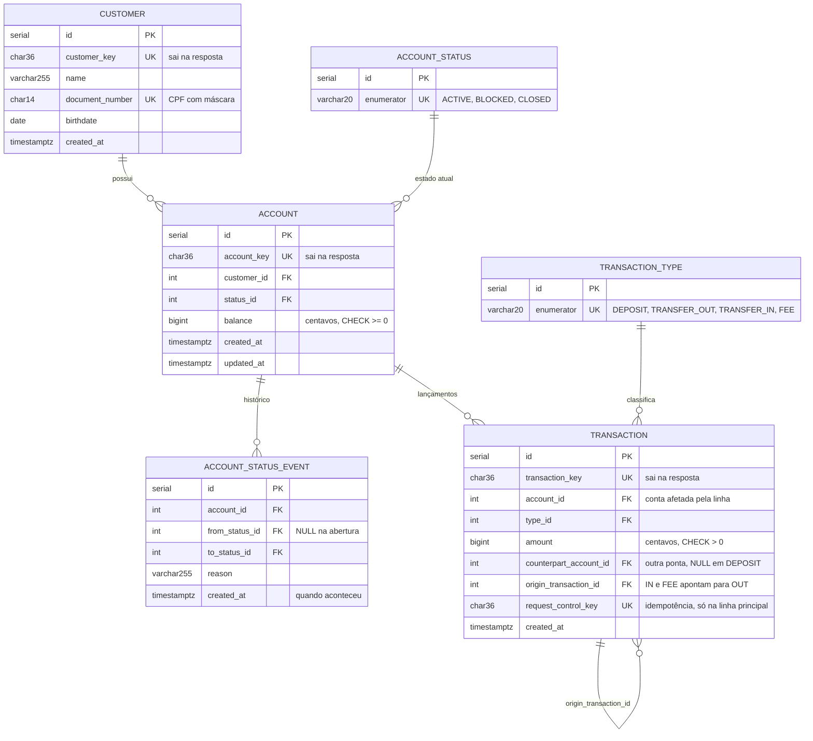

# Modelo de dados

> [Índice](../README.md) › Dados › Modelo
>
> **Responde a:** quais tabelas existem? o que garante unicidade? onde mora o saldo? o que é append-only?

O schema mora em `database/database.sql` e só roda quando o banco nasce: depois de mudá-lo, `make reset` ([rodando localmente](../06-operacao/rodando-localmente.md)).

## Diagrama



## DDL

Cópia fiel de [`database/database.sql`](../../database/database.sql), que é a fonte; atualize os dois juntos.

```sql
-- Roda só quando o volume do banco nasce: depois de mudar este arquivo, `make reset`.
-- Desenho e invariantes: docs/04-dados/modelo.md.

CREATE TABLE customer(
    id                              SERIAL PRIMARY KEY,
    customer_key                    CHAR(36) NOT NULL,
    name                            VARCHAR(255) NOT NULL,
    document_number                 CHAR(14) NOT NULL,
    birthdate                       DATE NOT NULL,
    created_at                      TIMESTAMPTZ NOT NULL DEFAULT(NOW()),
    UNIQUE(customer_key),
    UNIQUE(document_number)
);

CREATE TABLE account_status(
    id                              SERIAL PRIMARY KEY,
    enumerator                      VARCHAR(20) NOT NULL,
    created_at                      TIMESTAMPTZ NOT NULL DEFAULT(NOW()),
    UNIQUE(enumerator)
);

INSERT INTO account_status (enumerator) VALUES
('ACTIVE'),
('BLOCKED'),
('CLOSED');

CREATE TABLE account(
    id                              SERIAL PRIMARY KEY,
    account_key                     CHAR(36) NOT NULL,
    customer_id                     INTEGER NOT NULL REFERENCES customer(id),
    status_id                       INTEGER NOT NULL REFERENCES account_status(id),
    -- Centavos (R6). O CHECK é a última rede: o controller já valida com a conta travada.
    balance                         BIGINT NOT NULL DEFAULT 0,
    created_at                      TIMESTAMPTZ NOT NULL DEFAULT(NOW()),
    updated_at                      TIMESTAMPTZ NOT NULL DEFAULT(NOW()),
    UNIQUE(account_key),
    CONSTRAINT balance_non_negative CHECK (balance >= 0)
);

CREATE INDEX account_customer_id_idx ON account(customer_id);

-- Append-only (R4): uma linha por mudança de estado, inclusive a abertura (from_status_id NULL).
CREATE TABLE account_status_event(
    id                              SERIAL PRIMARY KEY,
    account_id                      INTEGER NOT NULL REFERENCES account(id),
    from_status_id                  INTEGER REFERENCES account_status(id),
    to_status_id                    INTEGER NOT NULL REFERENCES account_status(id),
    reason                          VARCHAR(255),
    created_at                      TIMESTAMPTZ NOT NULL DEFAULT(NOW())
);

CREATE INDEX account_status_event_account_id_idx ON account_status_event(account_id);

CREATE TABLE transaction_type(
    id                              SERIAL PRIMARY KEY,
    enumerator                      VARCHAR(20) NOT NULL,
    created_at                      TIMESTAMPTZ NOT NULL DEFAULT(NOW()),
    UNIQUE(enumerator)
);

INSERT INTO transaction_type (enumerator) VALUES
('DEPOSIT'),
('TRANSFER_OUT'),
('TRANSFER_IN'),
('FEE');

-- Append-only (R4): uma linha por conta afetada; o tipo define o sinal (docs/02-arquitetura/decisoes/0003-transacao-tabela-unica-com-tipo.md).
CREATE TABLE transaction(
    id                              SERIAL PRIMARY KEY,
    transaction_key                 CHAR(36) NOT NULL,
    account_id                      INTEGER NOT NULL REFERENCES account(id),
    type_id                         INTEGER NOT NULL REFERENCES transaction_type(id),
    amount                          BIGINT NOT NULL,
    counterpart_account_id          INTEGER REFERENCES account(id),
    origin_transaction_id           INTEGER REFERENCES transaction(id),
    -- Só a linha principal da operação carrega a chave; NULL repetido não fere o UNIQUE.
    request_control_key             CHAR(36),
    created_at                      TIMESTAMPTZ NOT NULL DEFAULT(NOW()),
    UNIQUE(transaction_key),
    UNIQUE(request_control_key),
    CONSTRAINT amount_positive CHECK (amount > 0)
);

CREATE INDEX transaction_statement_idx ON transaction(account_id, created_at DESC, id DESC);
```

## Invariantes

| Invariante | Quem garante |
|---|---|
| CPF único | `UNIQUE(document_number)` mais a checagem prévia no controller, para devolver 409 limpo |
| Saldo nunca negativo | `CHECK (balance >= 0)` mais o lock e a validação no controller ([ADR 0002](../02-arquitetura/decisoes/0002-saldo-em-coluna-com-lock.md)) |
| `balance = Σ créditos − Σ débitos` | Saldo e lançamentos gravados na mesma transação; conferido por teste |
| Pedido não executa duas vezes | `UNIQUE(request_control_key)` ([ADR 0006](../02-arquitetura/decisoes/0006-idempotencia-por-chave.md)) |
| Nada some (R4) | `transaction` e `account_status_event` só recebem `INSERT`, e nenhum repository tem `update`/`delete` para elas |
| Id interno não vaza (R5) | O DTO só serializa `*_key` |
