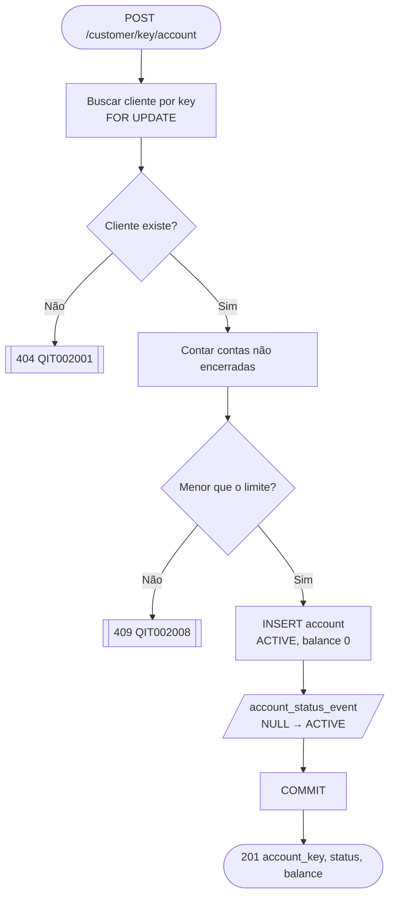

# Fluxo: abrir conta

> [Índice](../README.md) › Fluxos › Abrir conta
>
> **Responde a:** o cliente existe? ele pode abrir mais uma? em que estado a conta nasce?

## Caminho feliz

1. O controller busca o cliente pela `customer_key` com `with_for_update()`. O lock na linha do cliente serializa aberturas simultâneas, para que duas não passem juntas pelo limite.
2. O controller conta as contas com status diferente de `CLOSED`.
3. Abaixo de `MAX_ACCOUNTS_PER_CUSTOMER`, ele cria a conta `ACTIVE` com saldo 0 e grava o evento de nascimento.
4. Faz um commit e responde `201`.

## Caminhos de falha

| Condição | Resposta |
|---|---|
| `customer_key` inexistente (incluindo uma key válida de um cliente que não existe) | `404 QIT002001`. Não é 422, porque a key do path aponta para algo que não existe |
| Limite atingido | `409 QIT002008`, sem criar conta |
| Duas aberturas simultâneas no limite − 1 | A segunda espera o lock, recalcula a contagem e recebe `409` |

## As cinco perguntas da aula, respondidas

| Pergunta | Resposta |
|---|---|
| O cliente dessa chave existe? | Se não existir, `404` |
| Ele pode abrir mais uma? | Até `MAX_ACCOUNTS_PER_CUSTOMER` (padrão 3) não encerradas |
| Em que estado a conta nasce? | `ACTIVE`, por decisão do controller ([estados](../04-dados/estados.md)) |
| Onde mora o saldo? | Numa coluna, protegida por lock ([ADR 0002](../02-arquitetura/decisoes/0002-saldo-em-coluna-com-lock.md)) |
| Quem precisa ser avisado? | Ninguém nesta entrega. Notificação está fora do escopo |
