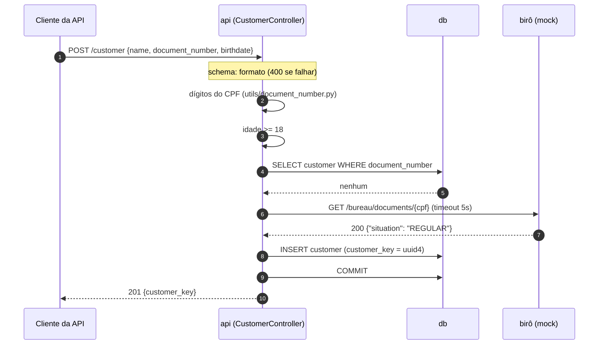

# Fluxo: criar cliente

> [Índice](../README.md) › Fluxos › Criar cliente
>
> **Responde a:** em que ordem as validações rodam? quando o birô é chamado? o que volta se ele cair?

## Caminho feliz

1. O schema confere o formato. O controller valida o dígito verificador, que é barato e local.
2. O controller valida a idade, também local.
3. O controller busca o CPF no banco. A busca vem antes do birô, para não gastar uma chamada externa num pedido que será recusado com 409.
4. O controller chama o birô pelo `BureauConnector`, com timeout. Nenhum lock é mantido durante a chamada HTTP.
5. Com `REGULAR`, o controller faz o `INSERT` e o commit. A resposta é `201`.

## Caminhos de falha

| Passo | Condição | Resposta | O que não acontece |
|---|---|---|---|
| 1 | Dígito verificador errado | `422 QIT002003` | birô não é chamado |
| 2 | Menor de 18 | `422 QIT002004` | birô não é chamado |
| 3 | CPF já existe | `409 QIT002002` | birô não é chamado |
| 4 | Birô diz `SUSPENDED`/`CANCELED`/`404` | `422 QIT002005` | nada é gravado |
| 4 | Birô estoura timeout, 5xx ou corpo inválido | `502 QIT002006` | nada é gravado; o pedido pode ser repetido |
| 5 | Dois POSTs simultâneos com o mesmo CPF passam do passo 3 | O segundo bate no `UNIQUE` no commit, o controller traduz para `409 QIT002002` | não surge cliente duplicado |

**Falha mais cara: birô fora do ar.**

1. O connector levanta `BureauUnavailable` ao estourar o timeout.
2. O controller não grava nada.
3. A resposta é `502`.
4. O log registra a tentativa com o `request_id`.
5. Quem chamou pode tentar de novo com segurança: a operação não gravou nada e o CPF continua livre.
