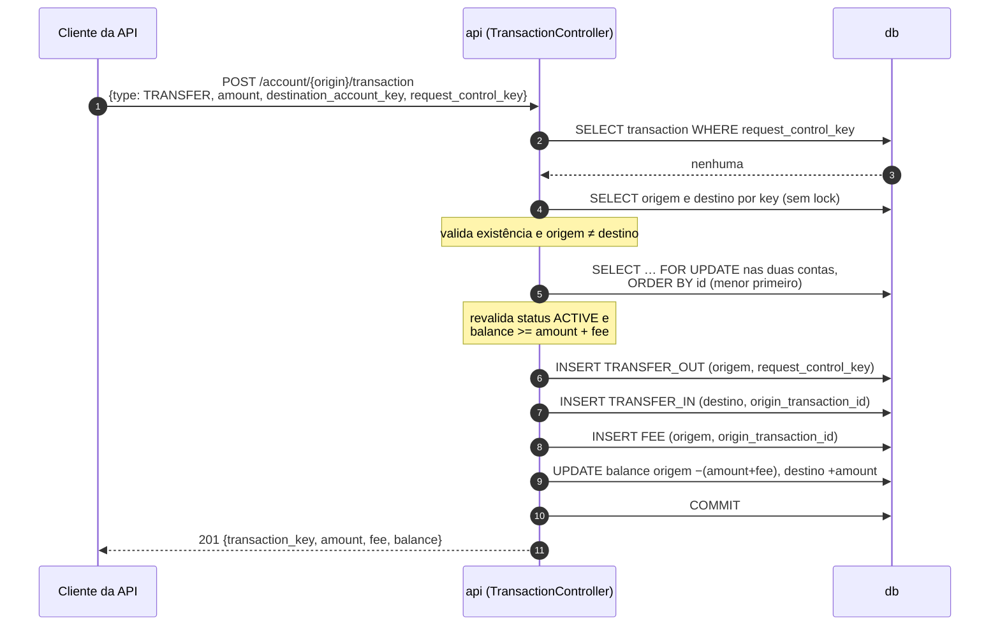

# Fluxo — transferência

> [Índice](../README.md) › Fluxos › Transferência
>
> **Responde a:** em que ordem as contas são travadas? o que acontece com saldo insuficiente? e se pedirem duas vezes ao mesmo tempo?

## Caminho feliz

1. **Idempotência.** O controller busca a `request_control_key`. Se a chave existe, ele compara o corpo: igual devolve `200` com o DTO original; diferente devolve `409 QIT002016`.
2. **Resolução.** O controller busca origem e destino pela key. Destino igual à origem devolve `422 QIT002013`; origem inexistente, `404 QIT002007`; destino inexistente, `404 QIT002014`.
3. **Lock.** O controller faz `with_for_update()` nas duas contas, **sempre em ordem crescente de `id`**. Assim A→B e B→A simultâneas não entram em deadlock.
4. **Revalidação depois do lock.** As duas contas precisam estar `ACTIVE` (senão `409 QIT002009`) e `balance` da origem precisa ser `>= amount + TRANSFER_FEE_CENTS` (senão `422 QIT002012`).
5. **Escrita.** O controller grava três lançamentos (`TRANSFER_OUT`, `TRANSFER_IN`, `FEE`) e dois `UPDATE` de saldo.
6. **Um commit**, no controller. A resposta é `201`.

## Caminhos de falha

**Saldo insuficiente** (o mais provável):

1. Nos passos 1 a 3, a origem tem `balance = 10000`, e o pedido é `amount = 10000` com fee 200.
2. No passo 4, `10000 < 10200`, e o controller levanta `InsufficientBalance`.
3. Nada foi gravado. O middleware `session_manager` faz rollback e libera os locks.
4. O cliente recebe `422 QIT002012`. **Os dois saldos ficam iguais a antes**, e um teste confere isso.

**Duas transferências simultâneas da mesma origem** (o mais caro):

1. As requisições T1 e T2 chegam juntas, e a origem tem R$ 100.
2. T1 trava a origem. T2 bloqueia no `FOR UPDATE`.
3. T1 debita R$ 80 + R$ 2, faz commit e libera o lock.
4. T2 acorda, **relê** o saldo de R$ 18, que agora é insuficiente, e responde `422`.
5. Sem o lock, as duas leriam R$ 100 e o `CHECK (balance >= 0)` barraria T2 com um 500. Isso é seguro, mas é um erro sem nome.

**Timeout do cliente com retry:**

1. T1 commita, mas a resposta se perde na rede.
2. O cliente repete com a mesma `request_control_key`.
3. No passo 1, a chave é encontrada e o corpo bate. O controller devolve `200` com a mesma transação, **sem debitar de novo**.

> ## Principal desafio
>
> - **Qual é:** garantir que o saldo nunca fique negativo nem divergente quando várias transferências tocam a mesma conta ao mesmo tempo, e quando a mesma transferência chega duas vezes.
> - **Por que é difícil:** o caminho óbvio (ler o saldo, validar, gravar) funciona sozinho e quebra em paralelo, porque as duas requisições leem o mesmo saldo. Já o retry depois de um timeout é indistinguível de um pedido novo sem uma chave.
> - **Como o desenho resolve:**
>   - `SELECT … FOR UPDATE` nas contas, em ordem de `id`, com a validação **depois** do lock.
>   - Um único commit para débito, crédito e tarifa.
>   - `CHECK (balance >= 0)` como rede de proteção.
>   - `UNIQUE(request_control_key)` para a repetição.
>   - Nenhuma chamada externa dentro do lock.
>   - Prova: `test_concurrent_transfers_never_make_balance_negative` e `test_repeated_request_control_key_returns_same_transaction`.
