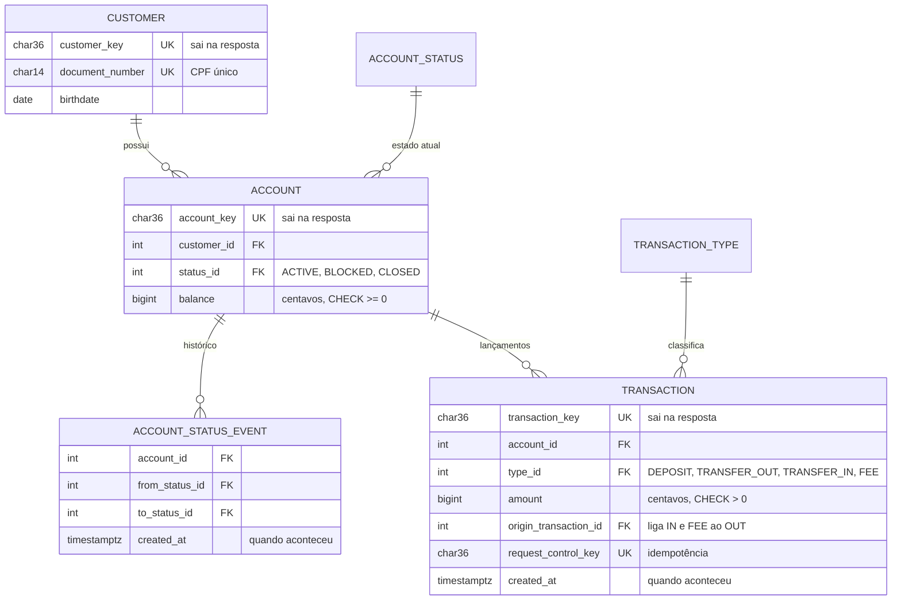

# RFC — Banco digital: cliente, conta, transferência com tarifa e extrato

| | |
|---|---|
| **Time** | \<nome 1\> · \<nome 2\> · \<nome 3\> |
| **Data** | \<dd/mm/aaaa\> |
| **Versão** | 1 |

> Derivada de [`docs/`](../README.md). Ao mudar o desenho, altere primeiro o documento de origem, depois esta RFC, e suba a versão.

## Contextualização

### Entendendo o problema

O serviço é o núcleo de um banco digital, chamado por outros sistemas internos com um token interno. Ele oferece cinco operações: cadastrar cliente (o CPF é conferido num birô externo, que pode estar fora do ar), abrir conta para um cliente, depositar, transferir entre contas cobrando uma tarifa e consultar o extrato paginado.

Sobre o dinheiro, o serviço sustenta quatro garantias:

- **Saldo nunca negativo**, mesmo com transferências simultâneas na mesma conta. Se falhar, o banco empresta o que não tem.
- **Transferência tudo ou nada**: débito, crédito e tarifa entram juntos. Se falhar, o dinheiro some no meio do caminho.
- **Pedido repetido não executa duas vezes.** Se falhar, um retry depois de timeout cobra em dobro.
- **Nada que entrou deixa de existir**, e o extrato reconstrói o saldo. Se falhar, a auditoria perde o rastro.

Fora do escopo: saque, Pix, TED, boleto, estorno, edição ou exclusão de cliente, crédito, juros e notificação.

### Explicando a solução de forma macro

É uma API (FastAPI), um PostgreSQL e um MockServer no papel do birô, todos num `docker compose`. São três recursos aninhados por posse (`customer` → `account` → `transaction`).

- O saldo mora numa coluna `account.balance` em centavos (`BIGINT`), com `CHECK (balance >= 0)`.
- Toda movimentação vira lançamento append-only numa única tabela `transaction`, com tipo `DEPOSIT`, `TRANSFER_OUT`, `TRANSFER_IN` ou `FEE`. A tarifa é um lançamento próprio.
- Cada requisição é uma transação de banco confirmada por um único `commit` no controller.
- A concorrência é resolvida com `SELECT … FOR UPDATE` nas contas, sempre em ordem de `id`.
- A repetição é resolvida com `request_control_key` (UUID de quem chama) e `UNIQUE` no banco.
- O birô é chamado antes de qualquer lock, com timeout de 5s. Se ele falhar, a resposta é 502 e nada é gravado.

Alternativas descartadas (detalhes nos [ADRs](../02-arquitetura/decisoes/README.md)):

- **Saldo como soma das transações:** descartado porque cada leitura varre o histórico e o lock continua necessário. Ganharia com volume baixo e snapshots.
- **Lock otimista (`version`):** descartado porque contas muito movimentadas viram uma fila de 409 e retries. Ganharia se os conflitos fossem raros.
- **Uma tabela por tipo (`deposit`, `transfer`):** descartado porque o extrato vira um `UNION` e as regras se repetem. Ganharia se os tipos tivessem campos muito diferentes.
- **Três microsserviços:** descartado porque a transferência viraria transação distribuída (saga). Ganharia com times e deploys independentes.

## Implementação

### Rotas

Valores em centavos. Todas as rotas, exceto `/` e `/health_check`, exigem `INTERNAL-TOKEN`; sem ele, `403 QIT000002`. Qualquer corpo ou query fora do schema devolve `400 QIT000001`. Detalhe em [rotas.md](../03-api/rotas.md).

| Método | Caminho | O que faz | Entrada (campos que importam) | Saídas (status e quando) |
|---|---|---|---|---|
| `POST` | `/customer` | Cadastra cliente após o birô. Repetir não cria outro: `UNIQUE(document_number)` | `document_number`, `birthdate` | `201 {customer_key}`; `422 QIT002003` CPF inválido, `QIT002004` menor de 18, `QIT002017` data de nascimento impossível, `QIT002005` irregular no birô; `409 QIT002002` CPF já cadastrado; `502 QIT002006` birô indisponível |
| `GET` | `/customer/{customer_key}` | Devolve o cliente | key | `200`; `404 QIT002001` |
| `GET` | `/customers` | Lista clientes, paginado | `limit`, `page` | `200 {data, limit, page, is_last_page}` |
| `POST` | `/customer/{customer_key}/account` | Abre conta `ACTIVE` com saldo 0 | key | `201 {account_key}`; `404 QIT002001`; `409 QIT002008` limite de contas |
| `GET` | `/account/{account_key}` | Conta, saldo e histórico de status | key | `200`; `404 QIT002007` |
| `PUT` | `/account/{account_key}/status` | Bloqueia, desbloqueia ou encerra | `status` | `200`; `404 QIT002007`; `409 QIT002010` transição inválida, `QIT002011` encerrar com saldo |
| `POST` | `/account/{account_key}/transaction` | Depósito ou transferência com tarifa. **Idempotente** por `UNIQUE(request_control_key)` | `type`, `amount`, `request_control_key`, `destination_account_key` | `201`; `200` repetição com o mesmo corpo; `404 QIT002007`/`QIT002014`; `409 QIT002009` conta não ativa, `QIT002016` chave com outro corpo; `422 QIT002012` saldo insuficiente, `QIT002013` mesma conta |
| `GET` | `/account/{account_key}/transactions` | Extrato paginado | `limit`, `page`, `type` | `200`; `404 QIT002007` |
| `GET` | `/account/{account_key}/transaction/{transaction_key}` | Um lançamento **da conta** | keys | `200`; `404 QIT002015`, inclusive se for de outra conta |

### Banco de Dados (Somente diagrama)

### Fluxos

Detalhe e diagramas em [05-fluxos/](../05-fluxos/transferencia.md).

**Transferência — caminho feliz**

1. Busca a `request_control_key`. Se não existe, segue.
2. Resolve origem e destino pela key. Origem igual a destino devolve `422`.
3. Trava as duas contas com `FOR UPDATE`, na ordem do menor `id`.
4. Revalida depois do lock: as duas contas estão `ACTIVE` e `balance >= amount + fee`.
5. Grava `TRANSFER_OUT`, `TRANSFER_IN` e `FEE`, e atualiza os dois saldos.
6. Faz um `commit` e responde `201`.

**Transferência — falha: saldo insuficiente**

1. No passo 4, `balance < amount + fee`, e o controller levanta `InsufficientBalance`.
2. Nada foi gravado. O middleware faz rollback, os locks são liberados e a resposta é `422 QIT002012`. Os dois saldos ficam iguais a antes.

**Transferência — falha: retry depois de timeout**

1. O commit aconteceu, mas a resposta se perdeu. O cliente repete com a mesma chave.
2. No passo 1, a chave é encontrada e o corpo é igual. A resposta é `200` com a transação original, sem novo débito. Se o corpo for diferente, `409 QIT002016`.

**Cadastro de cliente — falha: birô fora do ar**

1. Os checks locais (dígito, idade, duplicidade) passam. O birô não responde em 5s.
2. O connector levanta `BureauUnavailable`. Nada é gravado e a resposta é `502 QIT002006`. Repetir é seguro.

> ## Principal desafio
>
> - **Qual é:** manter o saldo correto quando várias transferências tocam a mesma conta ao mesmo tempo, e quando a mesma transferência chega duas vezes.
> - **Por que é difícil:** ler, validar e gravar funciona sozinho e quebra em paralelo, porque as duas requisições leem o mesmo saldo. E um retry depois de timeout é indistinguível de um pedido novo.
> - **Como o desenho resolve:**
>   - `SELECT … FOR UPDATE` em ordem de `id`, com a validação **depois** do lock.
>   - Um único commit para os três lançamentos e os dois saldos.
>   - `CHECK (balance >= 0)` como rede de proteção.
>   - `UNIQUE(request_control_key)` com a regra mesmo corpo → 200 e corpo diferente → 409.
>   - Nenhuma chamada HTTP dentro do lock.
>   - Provado por `test_concurrent_transfers_never_make_balance_negative` e `test_repeated_request_control_key_returns_same_transaction`.

## Perguntas para o time decidir

| Pergunta | O que o autor defende |
|---|---|
| A tarifa deve ser cobrada também em depósito? | Não. O material pede tarifa só na transferência. |
| Uma conta `BLOCKED` deve receber crédito? | Não, para manter uma regra só (qualquer estado diferente de `ACTIVE` não movimenta). A outra posição é legítima, e o custo recai sobre quem envia. |
| A `request_control_key` deve ir no header em vez do corpo? | Corpo, porque o schema valida e segue o padrão interno da QI. O header seguiria o rascunho IETF. |
