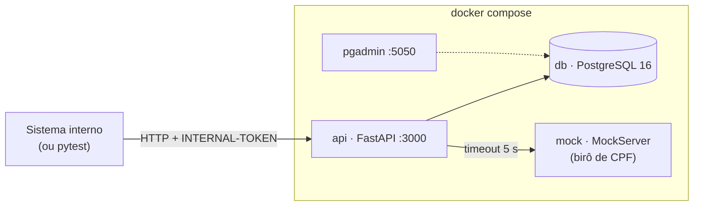
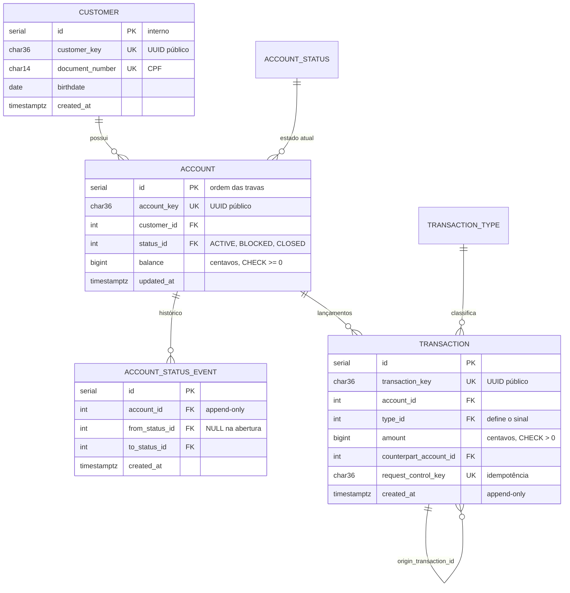
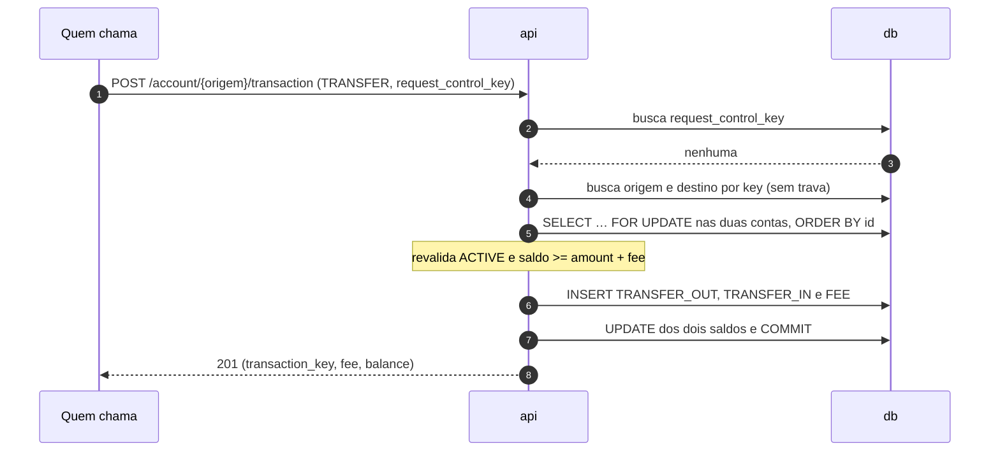

# RFC: Banco digital com saldo travado por conta e lançamentos append-only

| | |
|---|---|
| **Time** | Pedro H. S. Prestes · Laura Pazini Medeiros |
| **Data** | 11/10/2026 |
| **Versão** | 6 |

## Contextualização

### Entendendo o problema

O sistema é o núcleo de um banco digital, chamado por outros sistemas internos. Ele cadastra clientes, abre contas, recebe depósitos, transfere entre contas cobrando uma tarifa fixa e mostra o extrato paginado de cada conta. Todo CPF novo é conferido num birô externo, que pode demorar ou estar fora do ar.

Sobre o dinheiro, ele garante cinco coisas: o saldo nunca fica negativo, mesmo com duas operações simultâneas na mesma conta; a transferência é tudo ou nada, com débito, crédito e tarifa entrando juntos; um pedido repetido depois de um timeout não executa duas vezes; nada que entrou é apagado, e o extrato reconstrói o saldo; o valor é exato, sem arredondamento. Se alguma falhar, o banco empresta o que não tem, cobra o cliente em dobro ou perde o rastro da auditoria.

Fora do escopo: saque, boleto, Pix, TED, estorno, edição ou exclusão de cliente, autenticação de usuário final, multi-moeda, crédito e juros.

### Explicando a solução de forma macro

O ponto de partida é a `bootcamp-base-api`, mantida como está: camadas, middlewares de token, request id e sessão, `SchemaHandler`, corpo de erro, `id` interno com `_key` UUID, enumerador com tabela de eventos e paginação. Esta proposta troca o exemplo `sample_entity` pelo domínio `customer` → `account` → `transaction` e acrescenta o que a base não tinha. O saldo mora numa coluna da conta, em centavos inteiros, com `CHECK (balance >= 0)`, travado por `SELECT … FOR UPDATE` sempre em ordem crescente de `id`. Toda movimentação vira um lançamento append-only numa tabela única `transaction` (`DEPOSIT`, `TRANSFER_OUT`, `TRANSFER_IN`, `FEE`); a tarifa é um lançamento próprio, e por isso o extrato fecha com o saldo. Um pedido repetido é reconhecido pela `request_control_key` enviada por quem chama e protegida por `UNIQUE`. O birô de CPF entra como um connector real, simulado por um MockServer no compose: é chamado antes de qualquer trava, com timeout de 5 s, e se falhar a resposta é 502 sem nada gravado. Um pgAdmin sobe ao lado só para inspecionar o banco.

- **Saldo como soma dos lançamentos:** descartado porque cada leitura varre o histórico e, para validar saldo sob concorrência, ainda é preciso travar algo. Ganharia com volume baixo e snapshots periódicos.
- **Não travar (o padrão) ou lock otimista:** sem trava, duas transferências leem o mesmo saldo e um débito se perde; com coluna `version`, conta movimentada vira fila de 409. Não travar ganharia com um único escritor por conta; o otimista, com conflitos raros.
- **Uma tabela e uma rota por tipo (`/deposit`, `/transfer`):** descartado porque o extrato vira `UNION` e paginação e idempotência são escritas duas vezes. Ganharia se os tipos tivessem campos muito diferentes.
- **Três microsserviços (cliente, conta, transação):** descartado porque a transferência viraria transação distribuída (saga). Ganharia com times e deploys independentes.

## Implementação

### Rotas

Herdado da base e não repetido na tabela: `GET /` e `GET /health_check`; `INTERNAL-TOKEN` obrigatório (`403 QIT000002`); corpo ou query fora do JSON Schema, inclusive campo desconhecido (`400 QIT000001`); erro com `{title, description, translation, code}`; envelope `{data, limit, page, is_last_page}` com `limit` 1–100. Novo: valores em centavos (`20000` = R$ 200,00), e recurso de outro dono responde 404, nunca 403.

| Método | Caminho | O que faz | Entrada (campos que importam) | Saídas (status e quando) |
|---|---|---|---|---|
| `POST` | `/customer` | Cadastra cliente após o birô. Idempotente pelo `UNIQUE(document_number)`: repetir não cria outro | `name`, `document_number` (`000.000.000-00`), `birthdate` | `201 {customer_key}`; `422 QIT002003` CPF inválido; `422 QIT002017` data inexistente ou futura; `422 QIT002004` menor de 18; `409 QIT002002` CPF já cadastrado; `422 QIT002005` CPF irregular no birô; `502 QIT002006` birô indisponível |
| `GET` | `/customer/{customer_key}` | Devolve o cliente | key | `200`; `404 QIT002001` |
| `GET` | `/customers` | Lista clientes | `limit`, `page`, `document_number` | `200` envelope |
| `POST` | `/customer/{customer_key}/account` | Abre conta `ACTIVE` com saldo 0. Não idempotente: cada POST abre uma, até o limite | key | `201 {account_key, status, balance}`; `404 QIT002001`; `409 QIT002008` limite de 3 contas |
| `GET` | `/customer/{customer_key}/accounts` | Lista as contas do cliente | `limit`, `page` | `200` envelope; `404 QIT002001` |
| `GET` | `/account/{account_key}` | Conta, saldo e histórico de estados | key | `200`; `404 QIT002007` |
| `PUT` | `/account/{account_key}/status` | Bloqueia, desbloqueia ou encerra. Repetir o mesmo estado devolve 409 | `status`, `reason` | `200`; `404 QIT002007`; `409 QIT002010` transição inválida; `409 QIT002011` encerrar com saldo |
| `POST` | `/account/{account_key}/transaction` | Depósito ou transferência com tarifa. Idempotente por `UNIQUE(request_control_key)` | `type` (`DEPOSIT`, `TRANSFER`), `amount` ≥ 1, `request_control_key`, `destination_account_key` (só em `TRANSFER`) | `201 {transaction_key, type, amount, fee, balance}`; `200` repetição com o mesmo corpo; `404 QIT002007` origem; `404 QIT002014` destino; `409 QIT002009` conta não `ACTIVE`; `409 QIT002016` chave com outro corpo; `422 QIT002012` saldo < valor + tarifa; `422 QIT002013` destino = origem |
| `GET` | `/account/{account_key}/transactions` | Extrato, mais recentes primeiro | `limit`, `page`, `type` | `200` envelope; `404 QIT002007` |
| `GET` | `/account/{account_key}/transaction/{transaction_key}` | Um lançamento da conta | keys | `200`; `404 QIT002007`; `404 QIT002015` lançamento de outra conta |

### Banco de Dados (Somente diagrama)

### Fluxos

Como na base, a sessão vive uma requisição e o `commit` é a última linha do controller: qualquer erro antes dele desfaz tudo e, aqui, também libera as travas.

**Cadastro de cliente: caminho feliz**

1. Confere dígitos do CPF (validação da base), data e idade ≥ 18, tudo local.
2. Busca o CPF no banco, para não gastar chamada externa com um 409.
3. Chama o birô (timeout 5 s), sem nenhuma trava aberta.
4. Com `REGULAR`, grava o cliente, faz `commit` e responde `201`.

**Cadastro de cliente: falha do birô.** CPF fora de `REGULAR`, ou desconhecido (`404` do birô): `422 QIT002005`. Timeout, conexão caída, 5xx ou corpo sem `situation`: `502 QIT002006`, nada gravado, repetir é seguro. Dois cadastros simultâneos do mesmo CPF: o segundo bate no `UNIQUE` e recebe `409 QIT002002`.

**Abertura de conta.** Trava o cliente (`FOR UPDATE`), conta as contas não encerradas e, abaixo de 3, cria a conta `ACTIVE` e o evento `NULL → ACTIVE`. Falha: no limite, `409 QIT002008`; duas aberturas simultâneas são serializadas pela trava, e a segunda recebe 409.

**Mudança de estado.** Trava a conta, confere a transição (`ACTIVE ⇄ BLOCKED`, `ACTIVE → CLOSED`, `CLOSED` é final) e grava o estado novo e uma linha em `account_status_event` no mesmo `commit`. Só `ACTIVE` movimenta dinheiro. Falha: transição inválida, inclusive pedir o estado atual, `409 QIT002010`; encerrar com saldo, `409 QIT002011`.

**Transferência: caminho feliz**

Destino igual à origem é recusado antes da trava (`422 QIT002013`). A trava segue sempre do menor para o maior `id`, então A→B e B→A simultâneas não entram em deadlock, e a validação vem depois dela porque o saldo lido antes pode ter mudado. A tarifa é `TRANSFER_FEE_CENTS` (padrão 200).

**Transferência: duas simultâneas da mesma origem.** Origem com 10000; T1 e T2 pedem 8000. T1 trava, debita 8200 e faz `commit`. T2 esperava no `FOR UPDATE`, relê 1800 e recebe `422 QIT002012`. Nada de T2 é gravado.

**Transferência: retry depois de timeout.** A resposta de T1 se perde. Quem chamou repete com a mesma chave e o mesmo corpo: a chave é achada no passo 1 e volta `200` com a transação original, sem novo débito. Mesma chave com outro corpo: `409 QIT002016`. O depósito segue o mesmo fluxo, numa conta só e sem tarifa.

**Extrato.** Busca `limit + 1` linhas por `created_at DESC, id DESC`; a linha extra diz se há próxima página. Falha: `limit` 0 ou 101, `400 QIT000001`; página além do fim, `200` com `data: []`.

> **Principal desafio**
>
> - **Qual é:** manter o saldo certo quando várias transferências tocam a mesma conta ao mesmo tempo e quando a mesma transferência chega duas vezes.
> - **Por que é difícil:** ler o saldo, validar e gravar funciona com um pedido por vez e quebra em paralelo, porque os dois leem o mesmo saldo. Sem uma chave de quem chama, um retry é igual a um pedido novo.
> - **Como o desenho resolve:** `FOR UPDATE` em ordem de `id` com validação depois da trava; três lançamentos e dois saldos num único `commit`; `CHECK (balance >= 0)` como última rede; `UNIQUE(request_control_key)` com comparação do corpo; nenhuma chamada HTTP com trava aberta. Provado por `test_concurrent_transfers_never_make_balance_negative`, `test_crossed_transfers_do_not_deadlock` e `test_repeated_request_control_key_returns_same_transaction`; sem a trava, o primeiro fica vermelho.
