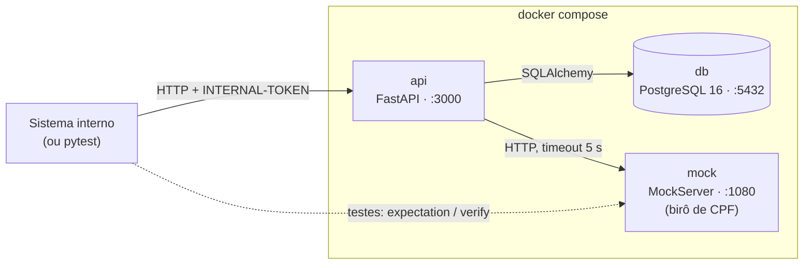
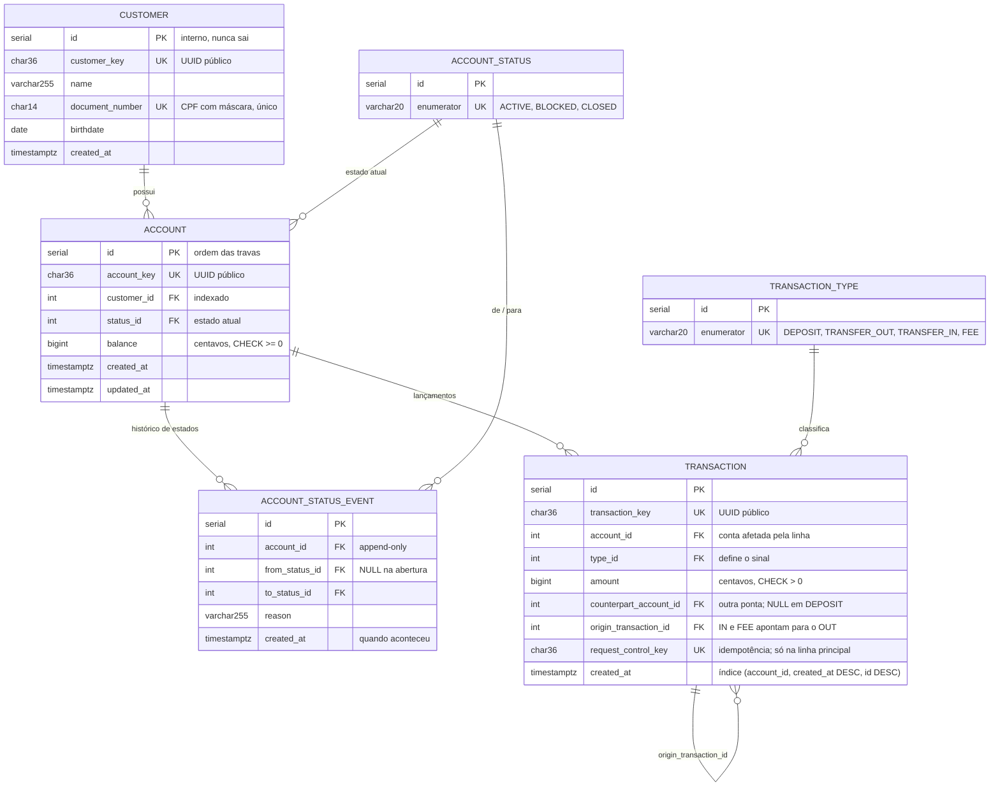
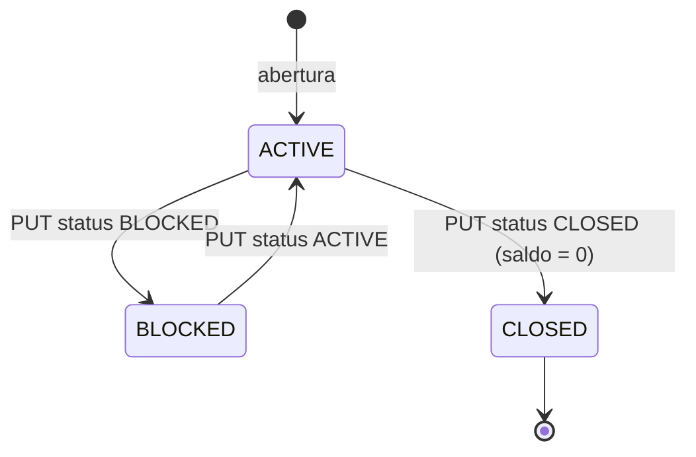

# RFC: Banco digital (cliente, conta, transferência com tarifa e extrato)

| | |
|---|---|
| **Time** | \<nome 1\> · \<nome 2\> · \<nome 3\> |
| **Data** | \<dd/mm/aaaa\> |
| **Versão** | 2 |

> Este documento descreve o sistema inteiro sem depender do repositório. O corpo (Contextualização e Implementação) segue o modelo da Aula 2. Os anexos A a J detalham regras, erros, contratos, decisões, arquitetura interna, operação e testes.

## Contextualização

### Entendendo o problema

O sistema é o núcleo de um banco digital. Outros sistemas internos o chamam para cinco operações: cadastrar cliente, abrir conta para um cliente, depositar, transferir entre contas cobrando uma tarifa e consultar o extrato paginado. O CPF de todo cliente novo é conferido num birô externo, que pode demorar ou estar fora do ar. Não há interface de usuário; quem chama se identifica com um token interno.

Sobre o dinheiro, o sistema sustenta cinco garantias:

| Garantia | O que acontece se falhar |
|---|---|
| Saldo nunca fica negativo, mesmo com duas operações simultâneas na mesma conta | O banco empresta o que não tem e o saldo diverge da realidade |
| Transferência é tudo ou nada: débito, crédito e tarifa entram juntos | O dinheiro sai de uma conta e não chega na outra, ou a tarifa some |
| Pedido repetido não executa duas vezes | Um retry depois de timeout cobra o cliente em dobro |
| Nada que entrou deixa de existir, e o extrato reconstrói o saldo | A auditoria perde o rastro |
| Dinheiro é exato | Arredondamento acumula centavos que não existem |

A parte difícil não é o caminho feliz. São três situações: duas transferências que leem o mesmo saldo ao mesmo tempo, um pedido repetido porque quem chamou não sabe se o primeiro passou, e o birô lento ou fora do ar.

Fora do escopo: saque, boleto, Pix, TED, estorno (a correção seria um lançamento novo), edição ou exclusão de cliente, autenticação de usuário final, multi-moeda, limite de crédito, juros e notificação a terceiros.

### Explicando a solução de forma macro

Uma API (Python 3.11 + FastAPI), um PostgreSQL 16 e um MockServer no papel do birô sobem juntos num `docker compose`. A API expõe três recursos aninhados por posse: `customer` → `account` → `transaction`. O saldo mora numa coluna da conta, em centavos inteiros, protegida por `CHECK (balance >= 0)`. Toda movimentação vira um lançamento append-only numa única tabela `transaction`, tipado como `DEPOSIT`, `TRANSFER_OUT`, `TRANSFER_IN` ou `FEE`; a tarifa é um lançamento próprio. Cada requisição é uma transação de banco fechada por um único `commit`. A concorrência é resolvida com `SELECT … FOR UPDATE` nas contas, sempre na ordem crescente de `id`, e a repetição com uma `request_control_key` enviada por quem chama e protegida por `UNIQUE`. O birô é consultado antes de qualquer trava, com timeout de 5 s; se falhar, a resposta é 502 e nada é gravado.



| Serviço | Imagem | Papel | Saúde |
|---|---|---|---|
| `api` | build local (`Dockerfile`, Python 3.11, usuário sem root) | Regras de cliente, conta e transação | `GET /health_check` a cada 3 s |
| `db` | `postgres:16` + `database/database.sql` aplicado na criação do volume | Fonte da verdade do saldo e do histórico | `pg_isready` |
| `mock` | `mockserver/mockserver:mockserver-5.11.1` | Responde como o birô; sobe vazio e cada teste configura a resposta | — |

Em produção, o `mock` dá lugar ao birô real, a API fica atrás de um API Gateway (única porta pública) e roda em N réplicas atrás de um load balancer. A API não guarda estado em memória entre requisições, então qualquer réplica atende qualquer pedido; a trava funciona entre réplicas porque quem trava é o Postgres.

Alternativas descartadas (todas no Anexo F):

- **Saldo calculado como soma dos lançamentos:** descartado porque cada leitura varre o histórico e, para validar saldo sob concorrência, ainda é preciso travar algo. Ganharia com volume baixo e snapshots periódicos.
- **Lock otimista (coluna `version`):** descartado porque contas muito movimentadas viram uma fila de 409 e retries. Ganharia se os conflitos fossem raros.
- **Uma tabela e uma rota por tipo (`/deposit`, `/transfer`):** descartado porque o extrato vira um `UNION` e paginação, ordenação e idempotência são escritas três vezes. Ganharia se os tipos tivessem campos muito diferentes.
- **Três microsserviços (clientes, contas, transações):** descartado porque a transferência viraria uma transação distribuída (saga). Ganharia com times e deploys independentes.

## Implementação

### Rotas

Regras que valem para todas as rotas:

- Valores monetários são inteiros em centavos (`20000` = R$ 200,00).
- Toda rota, exceto `/` e `/health_check`, exige o header `INTERNAL-TOKEN`. Sem ele ou com valor errado: `403 QIT000002`.
- Corpo ou query fora do JSON Schema da rota, inclusive campo ou parâmetro desconhecido: `400 QIT000001`.
- Rota inexistente: `404 QIT000404`. Método não aceito: `405 QIT000405`. Erro não previsto: `500 QIT000500`.
- Todo erro tem o corpo `{title, description, translation, code}` (Anexo B).
- Toda resposta traz o header `X-Request-ID`.
- Identificadores públicos são UUID (`<entidade>_key`); o `id` interno nunca sai.

| Método | Caminho | O que faz | Entrada (campos que importam) | Saídas (status e quando) | Idempotente? |
|---|---|---|---|---|---|
| `GET` | `/` | Identifica o serviço | — | `200 {service, id}` | sim (leitura) |
| `GET` | `/health_check` | Diz que a API está de pé, sem tocar o banco | — | `204` sem corpo | sim (leitura) |
| `POST` | `/customer` | Cadastra cliente depois de consultar o birô | `name`, `document_number` (`000.000.000-00`), `birthdate` (`AAAA-MM-DD`) | `201 {customer_key}`; `422 QIT002003` dígito verificador errado; `422 QIT002017` data inexistente ou futura; `422 QIT002004` menor de 18; `409 QIT002002` CPF já cadastrado; `422 QIT002005` CPF não `REGULAR` no birô; `502 QIT002006` birô indisponível | sim, por `UNIQUE(document_number)`: repetir devolve 409 e não cria outro |
| `GET` | `/customer/{customer_key}` | Devolve o cliente | key | `200`; `404 QIT002001` | sim (leitura) |
| `GET` | `/customers` | Lista clientes, mais novos primeiro | `limit`, `page`, `document_number` (filtro opcional) | `200 {data, limit, page, is_last_page}` | sim (leitura) |
| `POST` | `/customer/{customer_key}/account` | Abre conta `ACTIVE` com saldo 0 | key | `201 {account_key, status, balance}`; `404 QIT002001` cliente inexistente; `409 QIT002008` limite de contas atingido | não: cada POST abre uma conta, até o limite |
| `GET` | `/customer/{customer_key}/accounts` | Lista as contas do cliente | `limit`, `page` | `200` envelope; `404 QIT002001` | sim (leitura) |
| `GET` | `/account/{account_key}` | Conta, saldo, dono e histórico de estados | key | `200`; `404 QIT002007` | sim (leitura) |
| `PUT` | `/account/{account_key}/status` | Bloqueia, desbloqueia ou encerra | `status` (`ACTIVE`, `BLOCKED`, `CLOSED`), `reason` (opcional) | `200 {account_key, status, balance}`; `404 QIT002007`; `409 QIT002010` transição inválida (inclui pedir o estado atual); `409 QIT002011` encerrar com saldo | não: repetir o mesmo estado devolve 409 |
| `POST` | `/account/{account_key}/transaction` | Depósito ou transferência a partir da conta do path | `type` (`DEPOSIT`, `TRANSFER`), `amount` (≥ 1), `request_control_key` (UUID), `destination_account_key` (obrigatória em `TRANSFER`, proibida em `DEPOSIT`) | `201 {transaction_key, type, amount, fee, balance}`; `200` repetição com o mesmo corpo; `404 QIT002007` conta do path; `404 QIT002014` destino; `409 QIT002009` origem ou destino não `ACTIVE`; `409 QIT002016` chave reutilizada com outro corpo; `422 QIT002012` saldo insuficiente para valor + tarifa; `422 QIT002013` destino igual à origem | sim, por `UNIQUE(request_control_key)` |
| `GET` | `/account/{account_key}/transactions` | Extrato paginado, mais recentes primeiro | `limit`, `page`, `type` (filtro opcional) | `200` envelope; `404 QIT002007` | sim (leitura) |
| `GET` | `/account/{account_key}/transaction/{transaction_key}` | Um lançamento da conta | keys | `200`; `404 QIT002007`; `404 QIT002015` lançamento inexistente ou de outra conta | sim (leitura) |

Paginação: `limit` de 1 a 100 (padrão 10) e `page` a partir de 0 (padrão 0). O envelope é `{data, limit, page, is_last_page}`. Os contratos completos de entrada e saída estão no Anexo D.

Exemplo de transferência:

```http
POST /account/0b0c5e1a-…/transaction
INTERNAL-TOKEN: default_token
Content-Type: application/json

{"type": "TRANSFER", "amount": 20000, "destination_account_key": "7f2e…", "request_control_key": "c9a1…"}
```

```http
HTTP/1.1 201 Created
X-Request-ID: 4b1d…

{"transaction_key": "e3d2…", "type": "TRANSFER_OUT", "amount": 20000, "fee": 200, "balance": 79800}
```

### Banco de Dados (Somente diagrama)



### Fluxos

Em todos os fluxos, a sessão de banco é aberta por requisição. Se qualquer passo levanta erro, nada foi confirmado: a sessão faz rollback, as travas são liberadas e o cliente recebe o erro do passo. O `commit` é sempre a última linha do controller antes da resposta.

**Cadastro de cliente: caminho feliz**

1. O schema confere o formato de `name`, `document_number` e `birthdate`.
2. O controller confere os dígitos verificadores do CPF (local, barato).
3. Confere se a data existe e não está no futuro, e se o cliente tem 18 anos ou mais.
4. Busca o CPF no banco. A busca vem antes do birô para não gastar chamada externa com um pedido que será recusado com 409.
5. Chama o birô (`GET /bureau/documents/{cpf só dígitos}`, header `INTERNAL-TOKEN` do birô, timeout 5 s). Nenhuma trava está aberta durante a chamada.
6. Com `{"situation": "REGULAR"}`, grava o cliente com `customer_key` UUID v4, faz `commit` e responde `201 {customer_key}`.

**Cadastro de cliente: falhas**

| Passo | Condição | Resposta | O que não acontece |
|---|---|---|---|
| 2 | Dígito verificador errado ou todos os dígitos iguais | `422 QIT002003` | birô não é chamado |
| 3 | `1990-02-30` ou data futura | `422 QIT002017` | birô não é chamado |
| 3 | Menor de 18 | `422 QIT002004` | birô não é chamado |
| 4 | CPF já cadastrado | `409 QIT002002` | birô não é chamado |
| 5 | Birô responde `404` ou situação diferente de `REGULAR` | `422 QIT002005` | nada é gravado |
| 5 | Timeout, conexão caída, 5xx ou corpo sem `situation` | `502 QIT002006` | nada é gravado; repetir é seguro |
| 6 | Dois cadastros simultâneos do mesmo CPF passam do passo 4 | o segundo bate no `UNIQUE` no commit e recebe `409 QIT002002` | não surge cliente duplicado |

**Abertura de conta: caminho feliz**

1. O controller busca o cliente pela key com `FOR UPDATE`. A trava no cliente serializa aberturas simultâneas.
2. Conta as contas do cliente que não estão `CLOSED`.
3. Abaixo de `MAX_ACCOUNTS_PER_CUSTOMER` (padrão 3), cria a conta `ACTIVE` com saldo 0 e grava o evento de nascimento (`NULL → ACTIVE`).
4. `commit` e `201 {account_key, status, balance}`.

**Abertura de conta: falhas.** Cliente inexistente: `404 QIT002001`. Limite atingido: `409 QIT002008`, sem criar conta. Duas aberturas simultâneas com o cliente no limite menos um: a segunda espera a trava, recalcula a contagem e recebe `409`.

**Mudança de estado: caminho feliz**

1. O controller trava a conta (`FOR UPDATE`), para que um depósito concorrente não mude o saldo entre a checagem e o encerramento.
2. Confere a transição na máquina de estados (Anexo C) e, para `CLOSED`, que o saldo é 0.
3. Atualiza `status_id`, grava uma linha em `account_status_event` com `from`, `to` e `reason`, faz `commit` e responde `200`.

**Mudança de estado: falhas.** Conta inexistente: `404 QIT002007`. Transição fora da máquina (inclusive sair de `CLOSED`, ir de `BLOCKED` para `CLOSED` e pedir o estado atual): `409 QIT002010`. Encerrar com saldo diferente de 0: `409 QIT002011`. Nada é gravado em nenhum dos casos.

**Depósito: caminho feliz**

1. O repository procura um lançamento com a `request_control_key`. Não encontra.
2. O controller trava a conta e confere que está `ACTIVE`.
3. Grava o lançamento `DEPOSIT` com a chave, soma `amount` ao saldo, faz `commit` e responde `201 {transaction_key, type: "DEPOSIT", amount, fee: 0, balance}`.

**Depósito: falhas.** Chave já usada com o mesmo corpo: `200` com a resposta original, nada gravado. Chave já usada com outro corpo: `409 QIT002016`. Conta inexistente: `404 QIT002007`. Conta `BLOCKED` ou `CLOSED`: `409 QIT002009`. Dois pedidos simultâneos com a mesma chave nova: o segundo bate no `UNIQUE`, faz rollback e é respondido como repetição (`200`).

**Transferência: caminho feliz**

```mermaid
sequenceDiagram
    autonumber
    participant C as Quem chama
    participant API as api (TransactionController)
    participant DB as db
    C->>API: POST /account/{origem}/transaction {TRANSFER, amount, destination_account_key, request_control_key}
    API->>DB: SELECT transaction WHERE request_control_key
    DB-->>API: nenhuma
    API->>DB: SELECT origem e destino por key (sem trava)
    Note over API: origem ≠ destino; as duas existem
    API->>DB: SELECT … FOR UPDATE nas duas contas ORDER BY id
    Note over API: revalida ACTIVE e balance >= amount + fee
    API->>DB: INSERT TRANSFER_OUT (origem, request_control_key)
    API->>DB: INSERT TRANSFER_IN (destino, origin_transaction_id)
    API->>DB: INSERT FEE (origem, origin_transaction_id)
    API->>DB: UPDATE saldos: origem −(amount + fee), destino +amount
    API->>DB: COMMIT
    API-->>C: 201 {transaction_key, amount, fee, balance}
```

1. Procura a `request_control_key`. Se não existe, segue.
2. Resolve origem e destino pela key. Destino igual à origem: `422 QIT002013`. Origem inexistente: `404 QIT002007`. Destino inexistente: `404 QIT002014`.
3. Trava as duas contas com `FOR UPDATE`, sempre do menor para o maior `id`. Com a ordem fixa, A→B e B→A simultâneas não entram em deadlock.
4. Revalida depois da trava, porque o que foi lido antes pode ter mudado: as duas contas `ACTIVE` (senão `409 QIT002009`) e saldo da origem `>= amount + TRANSFER_FEE_CENTS` (senão `422 QIT002012`).
5. Grava três lançamentos (`TRANSFER_OUT` na origem, `TRANSFER_IN` no destino, `FEE` na origem) e atualiza os dois saldos.
6. Um `commit` e `201`. A resposta traz o `TRANSFER_OUT`, a tarifa cobrada e o saldo da origem logo após a operação.

**Transferência: saldo insuficiente**

1. A origem tem 10000 e o pedido é de 10000 com tarifa de 200. No passo 4, `10000 < 10200`.
2. O controller levanta `InsufficientBalance`. Nada foi gravado; o rollback libera as travas.
3. Resposta `422 QIT002012`. Os dois saldos ficam como estavam, e o teste confere isso.

**Transferência: duas simultâneas da mesma origem**

1. T1 e T2 chegam juntas; a origem tem 10000.
2. T1 trava a origem; T2 espera no `FOR UPDATE`.
3. T1 debita 8000 + 200, faz `commit` e libera a trava.
4. T2 acorda, relê o saldo (1800), que agora é insuficiente, e responde `422 QIT002012`.
5. Sem a trava, as duas leriam 10000: a segunda seria barrada pelo `CHECK` com um 500 sem nome, ou, com saldos que não ficam negativos, um débito se perderia (*lost update*).

**Transferência: retry depois de timeout**

1. T1 faz `commit`, mas a resposta se perde na rede.
2. Quem chamou repete com a mesma `request_control_key` e o mesmo corpo.
3. No passo 1 a chave é encontrada e o corpo bate (mesma conta, tipo, valor e destino). A resposta é `200` com o mesmo `transaction_key`, a mesma tarifa e o saldo logo após a operação original, reconstruído do extrato. Nada é debitado de novo.
4. Se o corpo for diferente, `409 QIT002016`.

**Extrato: caminho feliz**

1. O schema da query confere `limit`, `page` e `type`.
2. O controller busca a conta (`404 QIT002007` se não existe).
3. O repository busca `limit + 1` linhas ordenadas por `created_at DESC, id DESC`, com `OFFSET page × limit`. A linha a mais só serve para saber se há próxima página.
4. A resposta é `{data, limit, page, is_last_page}`. Cada linha traz `direction` (`CREDIT` ou `DEBIT`), derivado do tipo.

**Extrato: falhas.** `limit=0`, `limit=101`, `page=-1` ou parâmetro desconhecido: `400 QIT000001`. Página além do fim: `200` com `data: []` e `is_last_page: true`.

O extrato reconstrói o saldo: `Σ(DEPOSIT + TRANSFER_IN) − Σ(TRANSFER_OUT + FEE) = balance`. Um teste percorre todas as páginas e confere a igualdade.

> ## Principal desafio
>
> - **Qual é:** manter o saldo correto quando várias transferências tocam a mesma conta ao mesmo tempo, e quando a mesma transferência chega duas vezes.
> - **Por que é difícil:** ler o saldo, validar e gravar funciona com um pedido de cada vez e quebra em paralelo, porque as duas requisições leem o mesmo saldo. Um retry depois de timeout é indistinguível de um pedido novo sem uma chave enviada por quem chama.
> - **Como o desenho resolve:**
>   - `SELECT … FOR UPDATE` nas contas, em ordem crescente de `id`, com a validação depois da trava.
>   - Um único `commit` para os três lançamentos e os dois saldos.
>   - `CHECK (balance >= 0)` como última rede.
>   - `UNIQUE(request_control_key)`: mesmo corpo devolve 200 com a resposta original; corpo diferente devolve 409.
>   - Nenhuma chamada HTTP com trava aberta.
>   - Provado por `test_concurrent_transfers_never_make_balance_negative`, `test_crossed_transfers_do_not_deadlock` e `test_repeated_request_control_key_returns_same_transaction`. O teste de concorrência foi validado por mutação: sem a trava, ele fica vermelho.

## Perguntas para o time decidir

| Pergunta | O que o autor defende |
|---|---|
| A tarifa deve ser cobrada também em depósito? | Não. O material pede tarifa só na transferência. |
| Uma conta `BLOCKED` deve receber crédito? | Não, para manter uma regra só (qualquer estado diferente de `ACTIVE` não movimenta). A outra posição é legítima, e o custo recai sobre quem envia. |
| A `request_control_key` deve ir no header em vez do corpo? | Corpo, porque o schema valida e segue o padrão interno da QI. O header seguiria o rascunho IETF. |

---

## Anexo A: Restrições e regras de negócio

Restrições do enunciado:

| # | Restrição | Como o sistema atende |
|---|---|---|
| R1 | Nenhum teste importa código da aplicação | Os testes falam com a API só por HTTP e nunca leem o banco |
| R2 | Sobe e roda com um comando numa máquina Linux limpa | `make all` (ou `docker compose up -d --wait` e `pytest`); todo valor de configuração tem padrão |
| R3 | Erro tem código próprio no corpo | `{title, description, translation, code}` com código `QIT…` único |
| R4 | Nada que entrou deixa de existir | `transaction` e `account_status_event` só recebem `INSERT` |
| R5 | Nenhum identificador devolvido é o número gerado pelo banco | `<entidade>_key` UUID v4; `id` só interno |
| R6 | Dinheiro não é float | `BIGINT` em centavos; o schema recusa decimal |
| R7 | Decisões registradas com as alternativas descartadas e o preço | Anexo F |
| R8 | Recurso de outro dono responde 404, não 403 | Toda busca aninhada filtra pelo pai |

Regras de negócio:

| ID | Regra | Recusa |
|---|---|---|
| RN01 | CPF no formato `000.000.000-00` | `400 QIT000001` |
| RN02 | Dígitos verificadores do CPF batem; dígitos todos iguais são inválidos | `422 QIT002003` |
| RN03 | CPF único entre clientes | `409 QIT002002` |
| RN04 | Cliente com 18 anos ou mais | `422 QIT002004` |
| RN04a | Data de nascimento existe e não está no futuro | `422 QIT002017` |
| RN05 | CPF `REGULAR` no birô; `404` do birô conta como irregular | `422 QIT002005` |
| RN06 | Birô fora do ar, lento ou com resposta inesperada | `502 QIT002006` |
| RN07 | Conta só para cliente existente | `404 QIT002001` |
| RN08 | No máximo `MAX_ACCOUNTS_PER_CUSTOMER` (padrão 3) contas não encerradas por cliente | `409 QIT002008` |
| RN09 | Conta nasce `ACTIVE`, saldo 0, com evento de abertura | — |
| RN10 | Transições: `ACTIVE ⇄ BLOCKED` e `ACTIVE → CLOSED`; `CLOSED` é final | `409 QIT002010` |
| RN11 | Só encerra com saldo 0 | `409 QIT002011` |
| RN12 | Só movimenta conta `ACTIVE`, na origem e no destino | `409 QIT002009` |
| RN13 | Valor inteiro em centavos, de 1 a 999.999.999.999 | `400 QIT000001` |
| RN14 | Transferência exige saldo para valor + tarifa; sem saldo, nenhum saldo muda | `422 QIT002012` |
| RN15 | Não transfere para a mesma conta | `422 QIT002013` |
| RN16 | Conta de destino existe | `404 QIT002014` |
| RN17 | Tarifa `TRANSFER_FEE_CENTS` (padrão 200) debitada da origem na mesma transação | — |
| RN18 | Mesma `request_control_key` e mesmo corpo devolvem a resposta original sem executar de novo | `200` |
| RN19 | Mesma `request_control_key` com corpo diferente é recusada | `409 QIT002016` |
| RN20 | Lançamento de outra conta não aparece | `404 QIT002015` |
| RN21 | Paginação: `limit` 1–100 (padrão 10), `page` ≥ 0 (padrão 0) | `400 QIT000001` |
| RN22 | Toda rota, exceto `/` e `/health_check`, exige `INTERNAL-TOKEN` | `403 QIT000002` |

## Anexo B: Catálogo de erros

Corpo de toda recusa:

```json
{
  "title": "Insufficient Balance",
  "description": "Origin account balance does not cover amount plus fee.",
  "translation": "Saldo insuficiente para o valor mais a tarifa.",
  "code": "QIT002012"
}
```

`title` e `description` em inglês; `translation` em português. Cada erro é uma classe com código único, e a API não sobe se dois erros compartilharem um código. Nunca há `200` com erro no corpo.

| Código | HTTP | Quando |
|---|---|---|
| `QIT000001` | 400 | Corpo ou query fora do schema |
| `QIT000002` | 403 | `INTERNAL-TOKEN` ausente ou errado |
| `QIT000010` | 400 | Parâmetro de path ou query com tipo inválido (reservado; hoje o schema barra antes) |
| `QIT000404` | 404 | Rota inexistente |
| `QIT000405` | 405 | Método não aceito na rota |
| `QIT000500` | 500 | Exceção não prevista; registrada com stack trace |
| `QIT002001` | 404 | `customer_key` inexistente |
| `QIT002002` | 409 | CPF já cadastrado |
| `QIT002003` | 422 | Dígitos verificadores do CPF não batem |
| `QIT002004` | 422 | Menor de 18 anos |
| `QIT002005` | 422 | Birô diz que o CPF não está `REGULAR`, ou não o conhece |
| `QIT002006` | 502 | Birô estourou o timeout, caiu, respondeu 5xx ou corpo inesperado |
| `QIT002007` | 404 | `account_key` do path inexistente |
| `QIT002008` | 409 | Cliente já tem o máximo de contas não encerradas |
| `QIT002009` | 409 | Origem ou destino em `BLOCKED` ou `CLOSED` |
| `QIT002010` | 409 | Transição fora da máquina de estados |
| `QIT002011` | 409 | Encerrar conta com saldo diferente de 0 |
| `QIT002012` | 422 | Saldo menor que valor + tarifa |
| `QIT002013` | 422 | Destino igual à origem |
| `QIT002014` | 404 | `destination_account_key` inexistente |
| `QIT002015` | 404 | Lançamento inexistente ou de outra conta |
| `QIT002016` | 409 | `request_control_key` já usada com outro corpo |
| `QIT002017` | 422 | Data de nascimento inexistente ou futura |

Critério de status: `400` quando o formato está errado; `422` quando o formato está certo mas o valor não pode existir; `409` quando o pedido conflita com o estado atual; `404` quando a key não existe ou pertence a outro dono; `502` quando a dependência externa falha; `500` é sempre um bug a nomear.

## Anexo C: Máquina de estados da conta



| Estado | Recebe depósito | Envia transferência | Recebe transferência | Conta no limite de contas |
|---|---|---|---|---|
| `ACTIVE` | sim | sim | sim | sim |
| `BLOCKED` | não (409) | não (409) | não (409) | sim |
| `CLOSED` (final) | não (409) | não (409) | não (409) | não |

A lista de estados mora no banco (`account_status`); a regra de transição mora no controller. Toda transição, inclusive a abertura, grava uma linha em `account_status_event` no mesmo `commit`. Não existe estado `CREATED`: a abertura não depende de aprovação externa, porque o birô é consultado no cadastro do cliente. O estado seria revisto se a abertura passasse a exigir análise de crédito (entraria `PENDING`).

## Anexo D: Contratos de entrada e saída

Todo schema de entrada usa `additionalProperties: false`: campo a mais é recusado, não ignorado. Isso barra *mass assignment* (enviar `balance` ou `status` no corpo de um POST). O schema confere formato; dígito verificador, idade e saldo são regras do controller.

| Rota | Entrada | Regras do schema |
|---|---|---|
| `POST /customer` | `{name, document_number, birthdate}` | todos obrigatórios; `name` 1–255; CPF `^\d{3}\.\d{3}\.\d{3}-\d{2}$`; data `^\d{4}-\d{2}-\d{2}$` |
| `PUT /account/{key}/status` | `{status, reason?}` | `status` ∈ `ACTIVE`, `BLOCKED`, `CLOSED`; `reason` 1–255 |
| `POST /account/{key}/transaction` | `{type, amount, request_control_key, destination_account_key?}` | `type` ∈ `DEPOSIT`, `TRANSFER`; `amount` inteiro 1–999.999.999.999; chave UUID; destino obrigatório em `TRANSFER` e proibido em `DEPOSIT` |
| `GET /customers` | `?limit&page&document_number` | `limit` 1–100; `page` 0–999.999.999; CPF com máscara |
| `GET /customer/{key}/accounts` | `?limit&page` | idem |
| `GET /account/{key}/transactions` | `?limit&page&type` | `type` ∈ os quatro tipos de lançamento |

Saídas:

| Recurso | Corpo |
|---|---|
| Cliente | `{customer_key, name, document_number, birthdate, created_at}` |
| Cliente criado | `{customer_key}` |
| Conta (detalhe) | `{account_key, customer_key, status, balance, created_at, status_events: [{from_status, to_status, reason, created_at}]}` |
| Conta (listagem) | `{account_key, customer_key, status, balance, created_at}` |
| Conta criada ou com estado alterado | `{account_key, status, balance}` |
| Operação (`POST …/transaction`) | `{transaction_key, type, amount, fee, balance}`; `type` é `DEPOSIT` ou `TRANSFER_OUT`, `balance` é o saldo da conta do path logo após a operação |
| Lançamento (extrato e detalhe) | `{transaction_key, type, direction, amount, counterpart_account_key, created_at}` |
| Página | `{data: [...], limit, page, is_last_page}` |

Datas em ISO 8601. Nenhuma resposta contém `id` ou campo terminado em `_id`.

Headers:

| Header | Direção | Regra |
|---|---|---|
| `INTERNAL-TOKEN` | entrada | obrigatório fora de `/` e `/health_check` |
| `X-Request-ID` | entrada e saída | opcional na entrada (`[A-Za-z0-9_-]{1,64}`); se faltar ou vier fora do formato, é gerado um UUID; sempre volta na resposta |
| `Content-Type` | entrada | `application/json` |

## Anexo E: Invariantes do modelo de dados

| Invariante | Quem garante |
|---|---|
| CPF único | `UNIQUE(document_number)`, com checagem prévia no controller para responder 409 limpo |
| Saldo nunca negativo | trava e validação no controller; `CHECK (balance >= 0)` como última rede |
| `balance = Σ créditos − Σ débitos` | saldo e lançamentos gravados no mesmo `commit`; conferido por teste |
| Valor positivo | `CHECK (amount > 0)`; o sinal vem do tipo |
| Pedido não executa duas vezes | `UNIQUE(request_control_key)`, preenchida só na linha principal (`DEPOSIT` ou `TRANSFER_OUT`); várias linhas `NULL` não ferem o `UNIQUE` |
| Nada some | `transaction` e `account_status_event` só recebem `INSERT`; nenhum repository tem `update` ou `delete` para elas |
| Id interno não vaza | o DTO só serializa `*_key` |
| Tarifa histórica preservada | o valor cobrado fica gravado na linha `FEE`; mudar a configuração não reescreve o passado |

| Tipo de lançamento | Efeito na conta da linha | Quando nasce |
|---|---|---|
| `DEPOSIT` | crédito | depósito |
| `TRANSFER_OUT` | débito | transferência, na origem |
| `TRANSFER_IN` | crédito | transferência, no destino |
| `FEE` | débito | tarifa, na origem |

Índices além das chaves: `account(customer_id)`, `account_status_event(account_id)` e `transaction(account_id, created_at DESC, id DESC)`, que atende o extrato numa consulta só.

## Anexo F: Decisões e alternativas descartadas

| Decisão | Alternativas descartadas e preço | Ganhariam se |
|---|---|---|
| Uma API + banco; birô como único serviço externo, simulado por MockServer | Três APIs separadas: transferência vira saga, três vezes mais compose e testes. Worker assíncrono: resposta deixa de ser final. Sem birô: perde connector, timeout e 502 | times e deploys independentes; liquidação externa lenta (Pix, TED); cadastro sem KYC |
| Saldo em coluna, `FOR UPDATE` em ordem de `id`, `CHECK >= 0` | Soma dos lançamentos: varre o histórico e ainda precisa de trava. Lock otimista: fila de 409 em conta movimentada. `UPDATE … WHERE balance >= v`: não cobre duas contas + tarifa + estado. Sem trava: *lost update* | volume baixo com snapshots; conflitos raros; débito simples numa conta só |
| Tabela única `transaction` com tipo; tarifa como lançamento `FEE` | Tabela por tipo: extrato vira `UNION`. Uma linha por transferência: sinal decidido em código, tarifa fora do extrato. Tarifa como coluna: extrato não reconstrói o saldo | tipos com campos muito diferentes; relatório principal por transferência |
| Dinheiro em `BIGINT` de centavos, BRL | `NUMERIC` + `Decimal`: disciplina para nunca virar float, JSON ambíguo. `FLOAT`: erro de arredondamento. String `"200.00"`: parse e regex no cliente | frações de centavo (juros, câmbio); API pública para front-end |
| `id` interno + `<entidade>_key` UUID pública | UUID como PK: índice e FKs maiores, quebra o padrão da base. Id sequencial exposto: permite enumeração e revela volume | ids gerados em vários serviços sem coordenação |
| Idempotência por `request_control_key` no corpo + `UNIQUE` | Header `Idempotency-Key`: schema não valida header. Tabela de respostas: escrita extra e resposta desatualizada. Deduplicar por janela de tempo: bloqueia transferências legítimas iguais | API pública no padrão IETF; muitas rotas de tipos diferentes |
| Item no singular, lista no plural, sem versão na URL | Tudo no plural: quebra o padrão da base. Rotas por ação: verbo na URL. `/v1`: sem cliente externo que justifique | projeto do zero com guia externo; API pública |
| Contrato de entrada em JSON Schema, não Pydantic | Pydantic: contrato preso ao Python. Preço do JSON Schema: o corpo chega como dicionário, sem autocompletar | time só Python, sem integradores externos |
| `AGENTS.md` como fonte única de instruções para agentes de código | Um arquivo por ferramenta: conteúdo duplicado diverge. Nada específico: agente erra regra escondida | time inteiro numa única ferramenta |

## Anexo G: Arquitetura interna

Caminho de uma requisição e o que cada camada pode fazer:

| Camada | Pode | Não pode |
|---|---|---|
| `middlewares/` | agir em toda requisição: request id, log, token, sessão | conhecer uma rota |
| `resources/` | receber HTTP, validar o schema, chamar um controller, escolher o status de sucesso | regra de negócio, `raise` |
| `schemas/` | descrever o JSON aceito | consultar banco |
| `controllers/` | decidir, chamar repositories e connectors, dar `commit` | escrever SQL, conhecer HTTP |
| `repositories/` | consultar e gravar; `FOR UPDATE` quando lê para decidir e gravar | decidir |
| `models/` | descrever tabelas | ter regra |
| `dtos/` | montar a resposta | consultar banco, expor `id` |
| `connectors/` | chamar serviço externo com timeout e traduzir falha em erro nosso | decidir regra |
| `errors/` | código, mensagem e status de cada erro | ter regra |

A dependência anda num sentido só: `resources → controllers → repositories → models`.

Middlewares, na ordem em que a requisição os atravessa:

1. `request_context`: define o `X-Request-ID`. Vem primeiro para que todas as linhas de log da requisição saiam com ele.
2. `request_logger`: registra entrada e saída com status e tempo. Vem antes do token para que as recusas 403 também apareçam no log.
3. `internal_token`: confere o token. Devolve a resposta 403 em vez de levantar exceção, porque em middleware não há tratador de exceção.
4. `session_manager`: prepara o contexto de banco, faz rollback se houver exceção e fecha a sessão sempre. Vem por último para que quem foi barrado não pegue sessão. Nunca dá `commit`.

A sessão é criada só quando um controller é construído; `/` e `/health_check` não usam controller e não dependem do banco. Ela viaja por `contextvars`, e só o controller a pede. O `commit` é a última linha do controller: só ele sabe se o trabalho terminou.

## Anexo H: Operação

**Como rodar.** Pré-requisitos: Docker com Compose v2 e, para os testes na máquina, Python 3.11 (o SQLAlchemy 2.0.23 fixado não importa no 3.12+).

| Comando | Faz |
|---|---|
| `make all` | sobe api, db e mock, espera ficarem saudáveis, cria o `.venv` com Python 3.11 e roda os testes |
| `make up` / `make test` | separadamente |
| `make lint` | `flake8 src tests`, precisa sair limpo |
| `make reset` | recria o banco do zero (o `database.sql` só roda quando o volume nasce) |
| `make rebuild` | reconstrói a imagem da api depois de mudar dependências |
| `make logs` | log da api |

**Configuração.** Nenhum arquivo precisa ser criado: todo valor tem padrão no compose, e um `.env` opcional sobrescreve.

| Variável | Padrão | Uso |
|---|---|---|
| `INTERNAL_TOKEN` | `default_token` | token exigido nas rotas |
| `API_PORT` / `DB_PORT` / `MOCK_PORT` | 3000 / 5432 / 1080 | portas na máquina |
| `BUREAU_API_URL` | `http://mock:1080/bureau` no compose | endereço do birô |
| `BUREAU_API_TIMEOUT` | 5 | segundos de espera pelo birô |
| `TRANSFER_FEE_CENTS` | 200 | tarifa por transferência |
| `MAX_ACCOUNTS_PER_CUSTOMER` | 3 | contas não encerradas por cliente |
| `APP_ENV` | `local` | `local`/`test` logam DEBUG; `production` loga INFO |

A API não sobe se `DATABASE_URL` ou `INTERNAL_TOKEN` faltarem.

**Segurança.**

- Autenticação: header `INTERNAL-TOKEN` comparado com a variável de ambiente. Em produção, cada serviço tem o próprio token e o API Gateway autentica quem vem de fora; o token interno nunca sai da rede interna.
- Autorização (IDOR): toda busca aninhada filtra pelo pai. Recurso de outro dono responde 404, porque 403 confirmaria que ele existe. Keys UUID impedem enumeração.
- Segredos só em variáveis de ambiente; `.env` fora do Git; o padrão `default_token` vale só para desenvolvimento.
- Entrada: `additionalProperties: false`; `X-Request-ID` validado com `fullmatch` contra *log injection*; SQL sempre parametrizado.
- Documentação automática (`/docs`, `/openapi.json`) desligada e cabeçalho de versão do servidor omitido.

| OWASP API Top 10 (2023) | Mitigação |
|---|---|
| API1 Broken Object Level Authorization | filtro pelo pai + 404 |
| API2 Broken Authentication | token obrigatório, vindo do ambiente |
| API3 Broken Object Property Level Authorization | schema fechado na entrada; DTO escolhe a saída |
| API4 Unrestricted Resource Consumption | `limit ≤ 100`; timeout no connector |
| API8 Security Misconfiguration | `/docs` desligado; sem versão do servidor |
| API10 Unsafe Consumption of APIs | resposta do birô validada; corpo inesperado vira 502 |

**Resiliência.**

| Resposta do birô | Interpretação | HTTP |
|---|---|---|
| `200 {"situation": "REGULAR"}` | segue | — |
| `200` com outra situação | CPF irregular | `422 QIT002005` |
| `404` | CPF desconhecido, tratado como irregular | `422 QIT002005` |
| timeout, conexão caída, 5xx, corpo sem `situation` | birô indisponível | `502 QIT002006` |

- O connector traduz "não respondeu" em erro; o controller decide o que cada resposta significa.
- Sem timeout, uma dependência lenta prenderia conexões até a API parar de responder sem estar caída.
- A API não faz retry no birô: devolve 502 rápido e quem chama decide. Retry é seguro porque o cadastro falha antes de gravar e a transação usa `request_control_key`. Recomendação a quem chama: backoff exponencial com jitter, mantendo a mesma chave.
- Circuit breaker fica fora do escopo; seria o próximo passo se o birô caísse com frequência.
- Escalar a API não escala o banco: cada réplica abre o próprio pool (5 conexões), e o limite real é o `max_connections` do Postgres.

**Observabilidade.**

- Formato do log: `data [nível] serviço.módulo [request_id] - mensagem`. O `X-Request-ID` liga todas as linhas de um pedido, inclusive as do connector (`OUTGOING`/`INCOMING` com status e tempo).
- Nunca são logados corpo da requisição, token ou CPF completo. A query string é logada, por isso segredo não viaja nela.
- `500 QIT000500` é registrado com stack trace e vira tarefa de nomear o erro.
- `GET /health_check` responde 204 sem tocar o banco, para que uma oscilação do banco não derrube réplicas sãs.

| Métrica proposta para produção | Alarme |
|---|---|
| Latência p95 | > 500 ms por 5 min |
| Taxa de 5xx | > 1% por 5 min |
| Taxa de 502 | > 5% por 5 min (birô degradado) |
| CPU e memória | CPU alta ou memória crescendo sem parar |

Todo alarme tem sinal, limite, prazo e dono, e pede uma ação.

## Anexo I: Testes

- **Black box.** 78 testes falam com a API só por HTTP, como um cliente real, e conferem status e corpo, inclusive o `code`. Nenhum importa a aplicação nem lê o banco (R1). Por isso sobrevivem a refatorações internas.
- **Cada teste cria o próprio mundo** pela API (CPF e keys novas) e não depende da ordem dos outros.
- **TDD.** Nenhuma linha nova de aplicação sem um teste vermelho pedindo; cada `if` tem um teste que passa e um que é barrado. Nome: `test_<ação>_<cenário>_returns_<status>`, com a regra citada na docstring.
- **Birô simulado.** O MockServer substitui só o que está fora da API; banco e camadas rodam de verdade. Cada teste configura a resposta para o seu CPF (`REGULAR`, `SUSPENDED`, `404`, `500`, corpo inesperado, conexão derrubada ou atraso maior que o timeout) e depois confere quantas vezes o birô foi chamado e com qual token. Nos 409 e 422 locais, confere que ele não foi chamado.

Matriz regra → teste:

| Regra | Teste que passa | Teste barrado |
|---|---|---|
| RN01 | `test_post_customer_returns_201_with_key` | `test_post_customer_with_unmasked_cpf_returns_400`, `test_post_customer_with_unknown_field_returns_400` |
| RN02 | `test_post_customer_returns_201_with_key` | `test_post_customer_with_invalid_cpf_returns_422` |
| RN03 | `test_post_customer_returns_201_with_key` | `test_post_customer_with_duplicate_cpf_returns_409` |
| RN04 / RN04a | `test_post_customer_adult_returns_201` | `test_post_customer_underage_returns_422`, `test_post_customer_with_impossible_date_returns_422` |
| RN05 | `test_post_customer_calls_bureau_once_with_its_token` | `test_post_customer_suspended_cpf_returns_422`, `test_post_customer_unknown_to_bureau_returns_422` |
| RN06 | `test_post_customer_after_bureau_failure_can_be_retried` | `test_post_customer_bureau_down_returns_502`, `test_post_customer_bureau_timeout_returns_502`, `test_post_customer_bureau_connection_dropped_returns_502`, `test_post_customer_bureau_unexpected_body_returns_502` |
| RN07 | `test_post_account_returns_201_active_zero_balance` | `test_post_account_unknown_customer_returns_404` |
| RN08 | `test_post_account_up_to_limit_returns_201`, `test_closed_account_frees_a_slot` | `test_post_account_over_limit_returns_409` |
| RN09 | `test_new_account_history_starts_at_opening` | — |
| RN10 | `test_put_account_status_block_and_unblock` | `test_put_account_status_closed_is_final_returns_409`, `test_put_account_status_same_status_returns_409`, `test_close_blocked_account_returns_409` |
| RN11 | `test_put_account_status_close_with_zero_balance_returns_200` | `test_close_account_with_balance_returns_409` |
| RN12 | `test_deposit_on_active_account_returns_201` | `test_deposit_on_blocked_account_returns_409`, `test_deposit_on_closed_account_returns_409`, `test_transfer_from_blocked_account_returns_409`, `test_transfer_to_closed_account_returns_409` |
| RN13 / R6 | `test_deposit_on_active_account_returns_201` | `test_deposit_with_zero_amount_returns_400`, `test_deposit_with_decimal_amount_returns_400` |
| RN14 | `test_transfer_debits_amount_plus_fee_and_credits_destination`, `test_transfer_of_exact_balance_minus_fee_leaves_zero` | `test_transfer_without_balance_returns_422_and_keeps_both_balances` |
| RN15 | — | `test_transfer_to_same_account_returns_422` |
| RN16 | — | `test_transfer_to_unknown_account_returns_404` |
| RN17 | `test_transfer_debits_amount_plus_fee_and_credits_destination`, `test_transfer_is_visible_in_both_statements` | — |
| RN18 | `test_repeated_request_control_key_returns_same_transaction`, `test_repeated_deposit_is_credited_once` | — |
| RN19 | — | `test_reused_request_control_key_with_other_amount_returns_409`, `test_reused_request_control_key_on_other_account_returns_409` |
| RN20 / R8 | `test_get_transaction_of_own_account_returns_200`, `test_get_customer_accounts_lists_only_own_accounts` | `test_get_transaction_of_other_account_returns_404` |
| RN21 | `test_statement_pagination_envelope`, `test_get_customers_pagination_envelope` | `test_statement_limit_over_100_returns_400`, `test_statement_limit_zero_returns_400`, `test_get_customers_with_unknown_param_returns_400` |
| RN22 | `test_home`, `test_health_check` | `test_no_token` |
| R4 | `test_statement_rebuilds_balance` | — |
| R5 | `test_get_customer_returns_200` (nenhum `id` nem `*_id` na resposta) | — |
| Concorrência | `test_crossed_transfers_do_not_deadlock` | `test_concurrent_transfers_never_make_balance_negative` |

## Anexo J: Glossário

| Termo | Significado aqui |
|---|---|
| ACID | Atomicidade (tudo ou nada), Consistência (constraints valem), Isolamento (uma transação não vê o rascunho da outra), Durabilidade (commit é permanente) |
| Append-only | Mudança vira linha nova; nada é editado nem apagado. Soft delete não conta |
| Birô | Serviço externo que informa a situação de um CPF |
| Black box | Teste que só usa HTTP e confere status e corpo |
| Connector | Camada que chama serviço externo com timeout e não decide regra |
| DTO | Converte o objeto do banco no JSON de saída |
| Enumerador | Tabela com a lista fixa de valores (estados, tipos) |
| `id` × `key` | `id` é o número interno; `<entidade>_key` é o UUID público |
| Idempotência | Repetir o mesmo pedido não executa a operação de novo |
| IDOR | Acessar recurso alheio trocando o identificador; aqui responde 404 |
| Lock pessimista | `SELECT … FOR UPDATE`: trava a linha até o commit |
| *Lost update* | Duas operações leem o mesmo valor e uma sobrescreve a outra |
| MockServer | Servidor HTTP que finge ser um serviço externo nos testes |
| `request_control_key` | UUID gerado por quem chama para identificar um pedido e permitir retry seguro |
| Request id | `X-Request-ID`, que liga todas as linhas de log de um pedido |
| Tarifa (`FEE`) | Valor cobrado da origem a cada transferência, gravado como lançamento |
